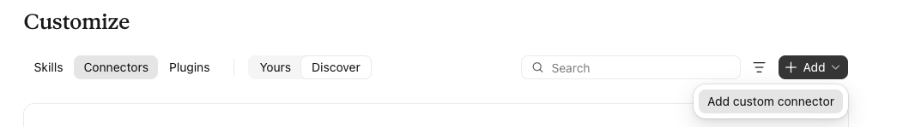
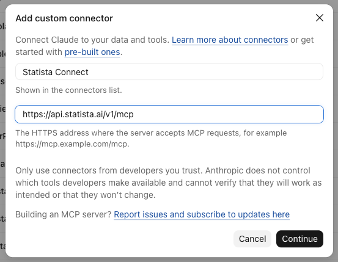
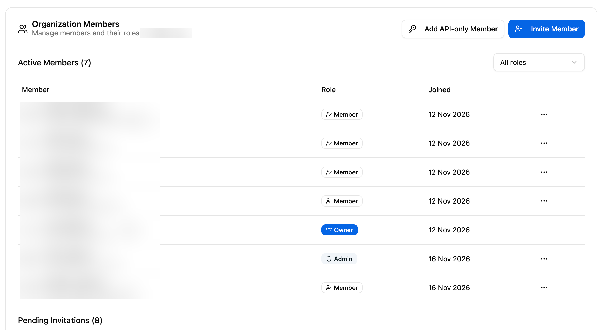
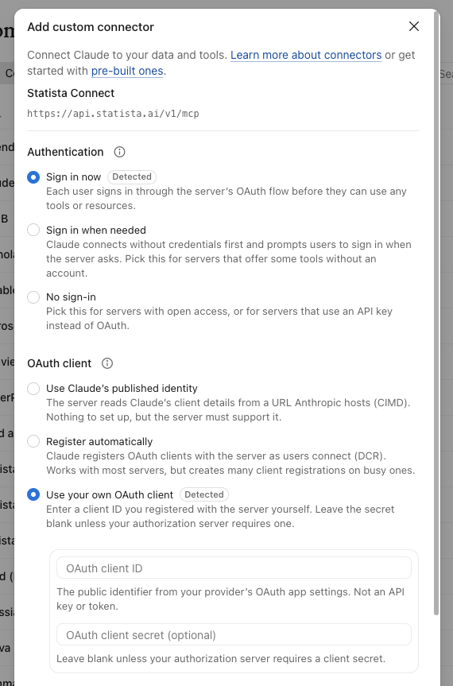
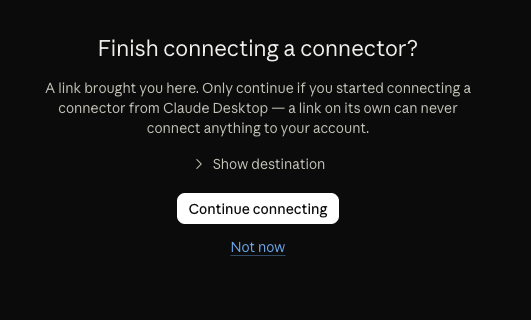
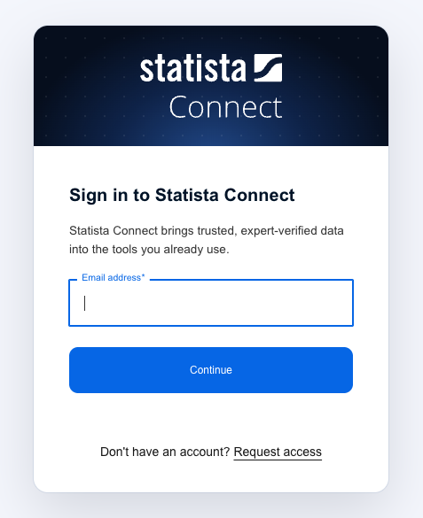
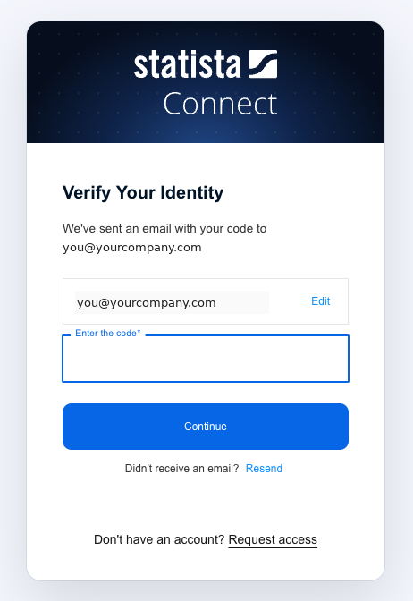
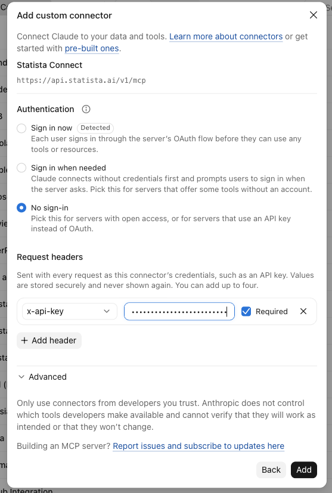
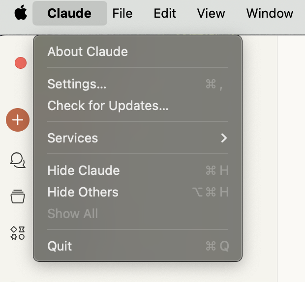
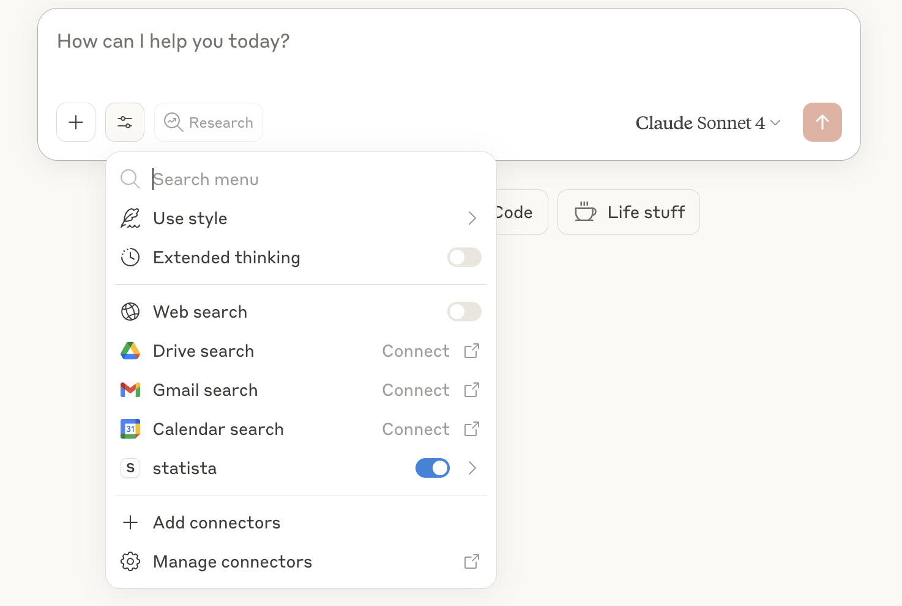

## Choose a path

Most people should use the **community connector** in Claude’s directory. Use a **custom connector** only if the Statista Connect team set up OAuth or gave you an API key for your organisation. **Claude Desktop (npx)** is a separate local setup.

<CardGroup cols={3}>
  <Card title="Community connector" icon="users" href="#community-connector">
    Find **Statista Connect** in Claude’s connector directory; sign in with your work email.
  </Card>
  <Card title="Custom connector" icon="plug" href="#custom-connector">
    Add the MCP URL yourself (OAuth client from Statista, or shared API key).
  </Card>
  <Card title="Claude Desktop (npx)" icon="desktop" href="#claude-desktop-npx">
    Edit `claude_desktop_config.json` on Mac or Windows.
  </Card>
</CardGroup>

## Community connector

Use this when **Statista Connect** appears in Claude’s connector browse/search (listed as a **Community** connector).

<Steps>
  <Step title="Open Connectors">
    In Claude, open **Customize → Connectors**.
  </Step>
  <Step title="Find Statista Connect">
    Search or browse for **Statista Connect** and open the listing.
  </Step>
  <Step title="Connect and sign in">
    Choose **Connect**, then sign in with your **Statista Connect work email** (one-time code by email). You must be an [active member](https://platform.statista.ai/) of your organisation.
  </Step>
  <Step title="Use in chat">
    In a new chat, open **+ → Connectors** and turn **Statista Connect** on. Mention Statista in your prompt so Claude uses the connector.
  </Step>
</Steps>

## Custom connector

Add the server manually when Statista onboarded your organisation with **your own OAuth app** or a **shared API key**.

<Warning>
  **OAuth client IDs** are issued only by the **Statista Connect team** during onboarding — not something you generate yourself. If you need a client ID or are unsure which path to use, contact your Statista representative or use **Feedback** in the docs header.
</Warning>

### Add the connector

<Steps>
  <Step title="Open the form">
    **Customize → Connectors → + Add → Add custom connector**.

    <Frame>
      
    </Frame>
    <Frame>
      
    </Frame>
  </Step>
  <Step title="Name and URL">
    - **Name:** `Statista Connect`
  - **Server URL:** `https://api.statista.ai/v1/mcp` (no trailing slash)
  - Click **Continue**
  </Step>
</Steps>

### Option A — OAuth (per user)

For teams where each person signs in with their own Statista Connect account. You need the **OAuth client ID from Statista**.

<Steps>
  <Step title="Platform access">
    Invited users must accept your organisation invitation on the [Developer Platform](https://platform.statista.ai/) before sign-in works.

    <Frame>
      
    </Frame>
  </Step>
  <Step title="Authentication settings">
    Keep **Sign in now** and **Use your own OAuth client**. Paste the **OAuth client ID** Statista provided. Leave **OAuth client secret** blank unless Statista told you otherwise. Click **Add**.

    <Frame>
      
    </Frame>
  </Step>
  <Step title="Finish sign-in in the browser">
    Complete email verification in the browser tab Claude opens.

    <Frame>
      
    </Frame>
    <Frame>
      
    </Frame>
    <Frame>
      
    </Frame>
  </Step>
</Steps>

### Option B — API key (no sign-in)

For a shared connector using one [Statista API key](/start/authentication).

<Steps>
  <Step title="No sign-in + header">
    Select **No sign-in** (not **Sign in now**). Under **Request headers**, add `x-api-key` with your API key, **Required** checked, then **Add**.

    <Frame>
      
    </Frame>

    <Info>
      Header values cannot be viewed again after save. Never paste API keys into OAuth fields or chats.
    </Info>
  </Step>
</Steps>

## Claude Desktop (npx)

Local **Claude Desktop** config via Node.js and `mcp-remote` — not the in-app connector UI above.

<AccordionGroup>
  <Accordion title="Set up Claude Desktop (Mac or Windows)" icon="desktop">
    <Tabs>
      <Tab title="Mac">
        Install [Claude Desktop](https://claude.ai/download) and [Node.js](https://nodejs.org/). **Settings → Developer → Edit Config**, then paste:

        ```json
        {
          "mcpServers": {
            "statista": {
              "command": "npx",
              "args": ["-y", "mcp-remote", "https://api.statista.ai/v1/mcp", "--transport", "http-only", "--header", "x-api-key: ${API_KEY}"],
              "env": { "API_KEY": "YOUR_API_KEY" }
            }
          }
        }
        ```

        <Frame>
          
        </Frame>
      </Tab>
      <Tab title="Windows">
        Install Node.js LTS, restart Windows, open `%APPDATA%\Claude\claude_desktop_config.json`. Use `C:\\PROGRA~1\\nodejs\\npx.cmd` as `command`:

        ```json
        {
          "mcpServers": {
            "statista": {
              "command": "C:\\PROGRA~1\\nodejs\\npx.cmd",
              "args": ["-y", "mcp-remote", "https://api.statista.ai/v1/mcp", "--transport", "http-only", "--header", "x-api-key: ${API_KEY}"],
              "env": { "API_KEY": "YOUR_API_KEY" }
            }
          }
        }
        ```
      </Tab>
    </Tabs>

    Restart Claude Desktop and enable **statista** under **Search and tools**.

    <Frame>
      
    </Frame>
  </Accordion>
</AccordionGroup>

## Troubleshooting

<AccordionGroup>
  <Accordion title="Could not connect">
    URL must be exactly `https://api.statista.ai/v1/mcp` with no trailing slash.
  </Accordion>
  <Accordion title="OAuth: no client ID">
    Contact the Statista Connect team — client IDs are not self-service.
  </Accordion>
  <Accordion title="OAuth: no access after sign-in">
    Accept your platform invitation or ask your admin to add you under **Active members**.
  </Accordion>
  <Accordion title="API key: Unauthorized">
    Header name must be `x-api-key`. Re-add the header and paste the key again (no spaces).
  </Accordion>
  <Accordion title="No data in answers">
    Turn the connector on in that chat and include “Statista” in the prompt.
  </Accordion>
</AccordionGroup>